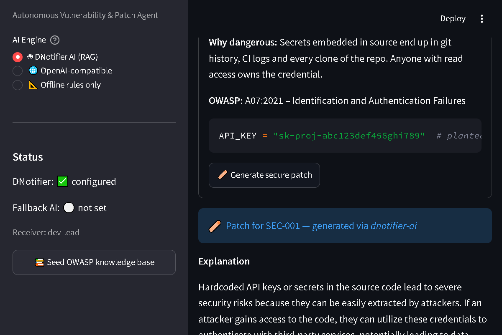
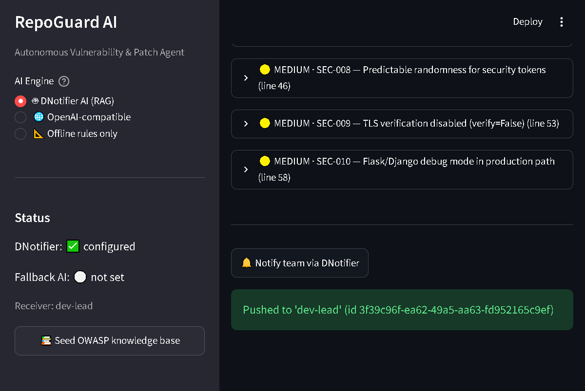

# 🛡️ RepoGuard AI — Autonomous Vulnerability & Patch Agent


An open-source, AI-powered security companion for developers and OSS
maintainers. Paste or upload Python/JavaScript code → RepoGuard finds
common vulnerabilities (hardcoded secrets, injection, weak crypto, unsafe
deserialization…), explains the risk in plain English with a concrete
**attack scenario**, proposes a **minimal secure patch**, and pushes a
**realtime alert** to your team — with [DNotifier](https://www.dnotifier.com)
powering the AI pipeline, the RAG knowledge base, and the messenger.

> ## 🌐 **[Live demo — click & it runs!](https://repoguard-ai-mmpfx9bdwp9tlsfd87x3be.streamlit.app)**




## ✨ Features (the three engines)

| Step | Module | What it does |
|------|--------|--------------|
| 1. **The Scout** | `repoguard/scanner.py` | 13 deterministic, OWASP-mapped rules — pure text analysis, *no code execution* |
| 2. **The Explainer / Auto-Patch Engineer** | `repoguard/patcher.py` | AI returns `EXPLANATION → ATTACK SCENARIO → PATCH → VERIFY` with ±12 lines of numbered context |
| 3. **The Messenger** | `repoguard/notifier.py` | Realtime push (`send`), RAG grounding (`add_document`), **executive security brief** (`send_ai`) |

Plus:

- 🖤 **Dark cyber UI** — animated gradient hero, glass KPI cards, neon severity
  bars, terminal-style editor, branded footer (see `repoguard/theme.py`)
- 🎨 **Dashboard**: security score, severity chart, colour-coded findings table (worst first)
- 🤖 **AI Security Brief**: one-screen `RISK OVERALL: n/10` + top priorities + quick wins
- 🧠 **3 AI engines**: DNotifier AI (RAG) → any OpenAI-compatible endpoint → offline rule hints
- 🛡️ **Security-hardened by design** (see below)

## 🚀 Quickstart (60 seconds)

```bash
git clone https://github.com/mabdullahch90-spec/repoguard-ai.git
cd repoguard-ai
python -m venv .venv
.venv\Scripts\activate          # macOS/Linux: source .venv/bin/activate
pip install -r requirements.txt
cp .env.example .env            # fill in DNotifier App ID + Secret
streamlit run app.py
```

Then in the browser:

1. Click **🧪 Load demo sample** → **🚀 Scan** → see score 0/100 + 8 findings
2. Expand a finding → **🩹 Generate secure patch** → explanation, attack scenario, diff, verify steps
3. **🤖 Generate executive summary** → prioritised AI brief for the whole scan
4. **🔔 Notify team via DNotifier** → realtime push with a message ID

> 💡 **No DNotifier account?** The app still works: pick *Offline rules only*
> for deterministic explanations, or point `OPENAI_BASE_URL` at any
> OpenAI-compatible endpoint (Ollama, LM Studio, vLLM…).

## 🏗️ Project structure

```
repoguard-ai/
├── app.py                  # Streamlit UI (entry point)
├── requirements.txt
├── .env.example            # config template (real .env is gitignored)
├── LICENSE                 # MIT
├── repoguard/
│   ├── config.py           # env-based settings (no hardcoded secrets)
│   ├── models.py           # Pydantic models (Finding, ScanResult, PatchResult)
│   ├── scanner.py          # The Scout — static rule engine
│   ├── patcher.py          # The Auto-Patch Engineer — pluggable AI engines
│   ├── notifier.py         # DNotifier bridge (notify + RAG + brief)
│   ├── utils.py            # async bridge, LLM output parsing
│   └── theme.py            # visual layer — dark neon theme, glass cards, KPIs
├── samples/
│   └── vulnerable_app.py   # demo file with 8 planted vulnerabilities
├── docs/screenshots/       # images used in this README
└── tests/
    └── test_scanner.py     # 11 offline unit tests
```

## 🛡️ Security design notes (why you can trust this tool)

- **Secrets never in source** — `.env` + `.gitignore`; config loaded at runtime (OWASP A02).
- **Uploads are data, never executed** — decoded with `errors="replace"`, size-capped, scanned as text only.
- **Prompt-injection hardening** — pasted code is fenced in `<untrusted_code>` tags; embedded
  instructions (e.g. a comment saying *"ignore previous instructions"*) are neutralised before
  reaching the model. This matters: *your code* can contain injection attempts.
- **Human-in-the-loop** — patches are *proposed* with a unified diff, never auto-committed.
- **Graceful degradation** — with no network/credits, the offline rule engine still explains and guides.
- **Input guardrails** — snippet size caps + AI timeouts keep resource use bounded.

## 🧪 Tests

```bash
pytest -q
# 11 passed
```

## 🎬 Judge demo script (3 minutes)

1. **Hook (10s):** "Every 2nd OSS repo leaks a secret or ships an injection bug. RepoGuard finds and patches them in seconds."
2. **Scan (30s):** Upload the sample → 8 findings, score 0/100, colour-coded table.
3. **Patch (40s):** Expand the CRITICAL one → watch the AI return explanation + attack scenario + `os.getenv()` patch + verify steps.
4. **Brief (30s):** "Generate executive summary" → `RISK OVERALL: 9/10` + prioritised fixes.
5. **Notify (20s):** 🔔 → realtime message ID via DNotifier.
6. **Close:** "Open source, MIT, offline-capable, and prompt-injection hardened — built defensive-first."

## 🗺️ Roadmap

- [ ] SARIF export for GitHub code-scanning upload
- [ ] Pre-commit hook mode (`repoguard scan --staged`)
- [ ] Taint-tracking for cross-line injection flows
- [ ] CI bot: PR comments via DNotifier realtime channel

## 📄 License

MIT — open source, built for **defensive security use only**.
Authorized testing of code you own or have permission to test. See [LICENSE](LICENSE).
